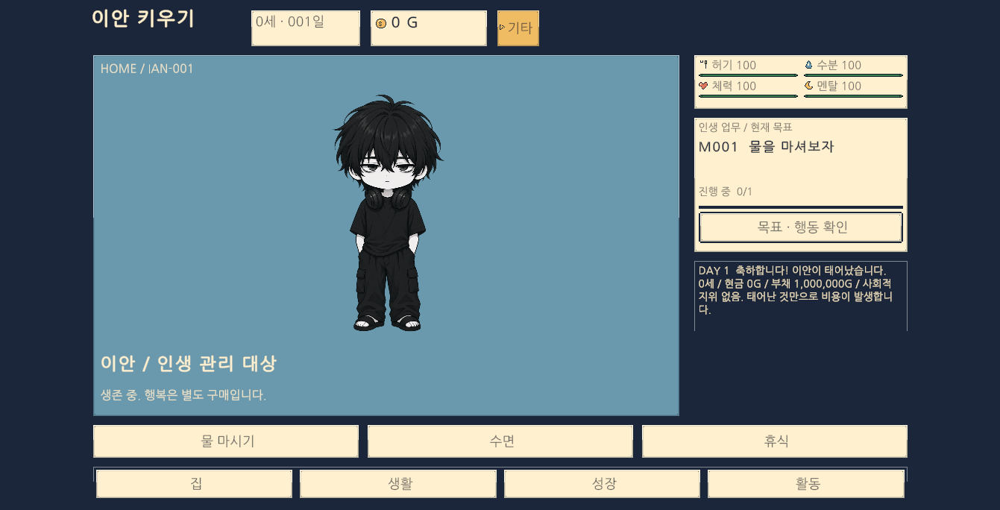
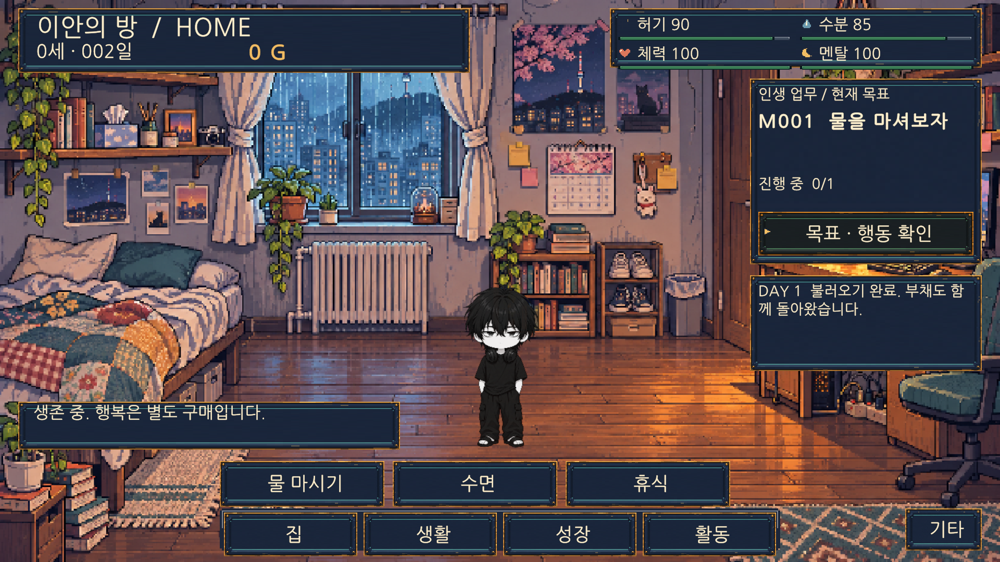
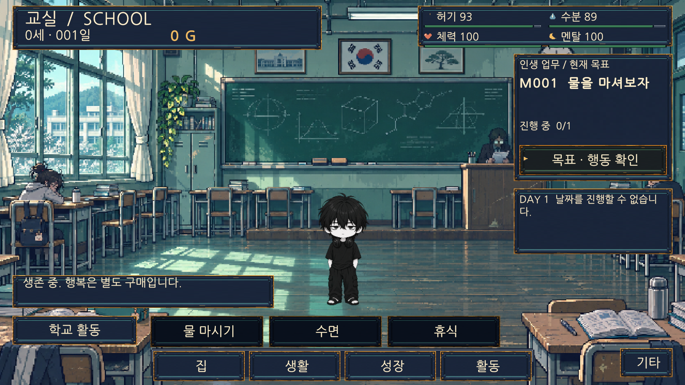
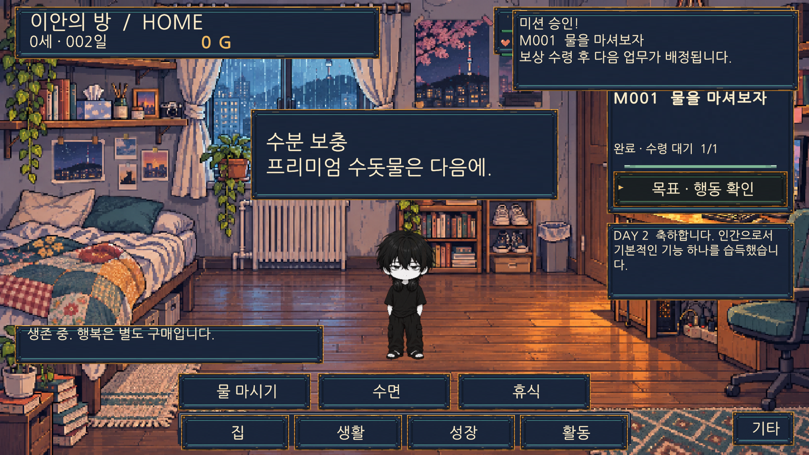
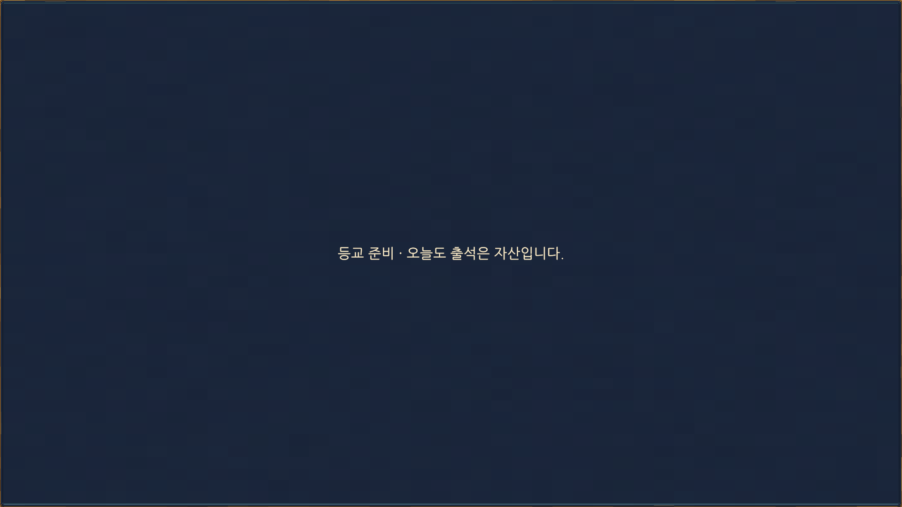
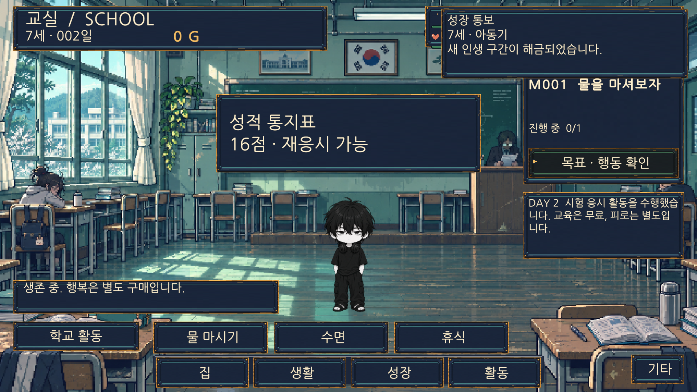

# Home ↔ School visual review

실제 Unity Game View 캡처다. Stage A 감사 및 Stage B 기능 슬라이스를 구현했다. 전체 상업용 그래픽 완성이나 Stage C/D 완료를 의미하지 않는다.

| 작업 전 Home | 작업 후 Home |
|---|---|
|  |  |

| School | 행동 피드백 |
|---|---|
|  |  |

| 이동 가림막 | 실제 시험 결과 (검토용 입학 fixture) |
|---|---|
|  |  |

- [1280×720](After/Home-1280x720.png) / [2400×1080](After/Home-2400x1080.png) / [캐릭터 확대 검사](After/Ian-Closeup.png)
- [감사·아트 디렉션](ART_DIRECTION.md)
- [검증 결과·제한 사항](VALIDATION.md)
- [신규 에셋·미제작 목록·제작 규격](ASSET_REGISTER.md)
- [새 화면 자동 검사 결과](SLICE_TEST_RESULTS.json)

`Draft`가 붙은 이미지는 수정 전 중간 결과이며 최종 비교 자료에 포함하지 않는다.

플레이 경로: Bootstrap → MainMenu → Home. 생활/성장/활동은 기존 모달 스택을 사용한다. 학교는 활동 → School로 이동한다. School의 학교 활동 버튼에서 기존 교육 기능을 연다. 기타 → 환경 설정에서 장소 전환(전체/짧게/끄기), 환경 효과(끄기/낮음/높음)를 선택한다.
