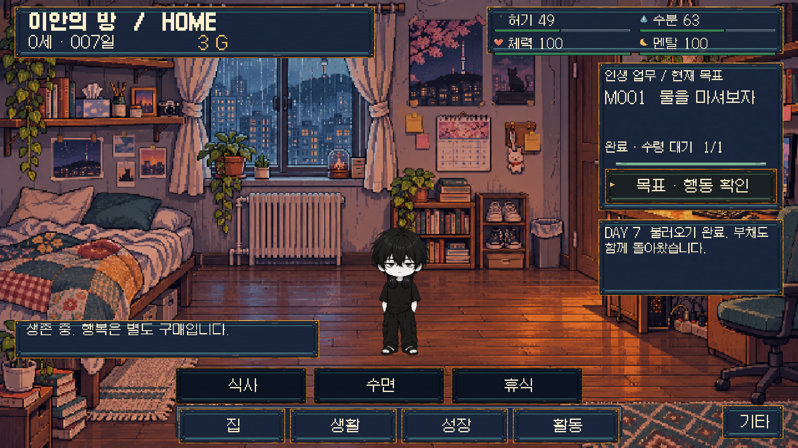
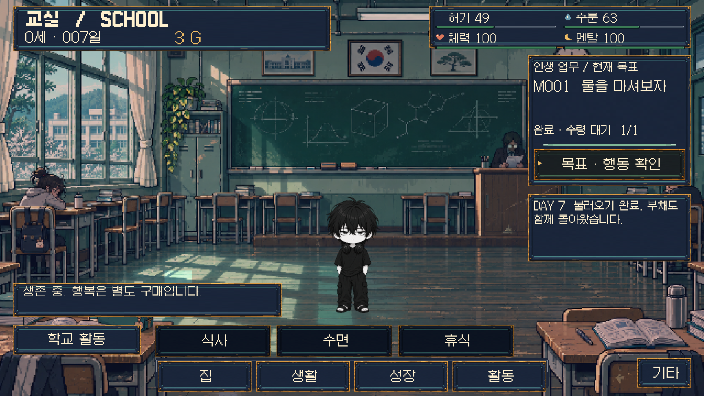
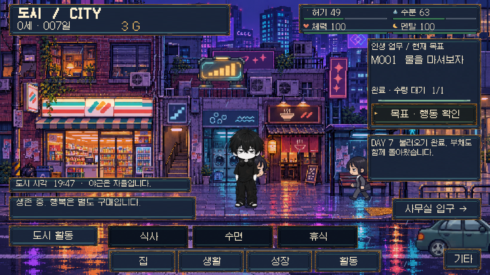
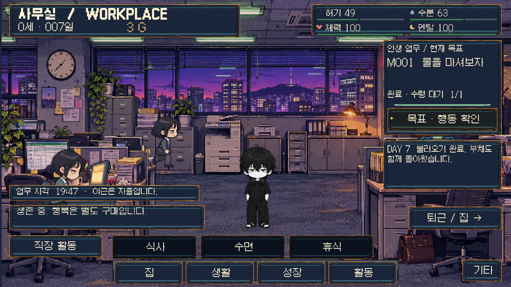
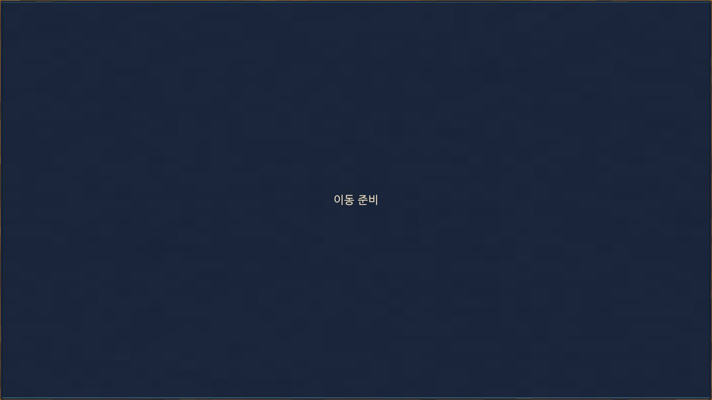
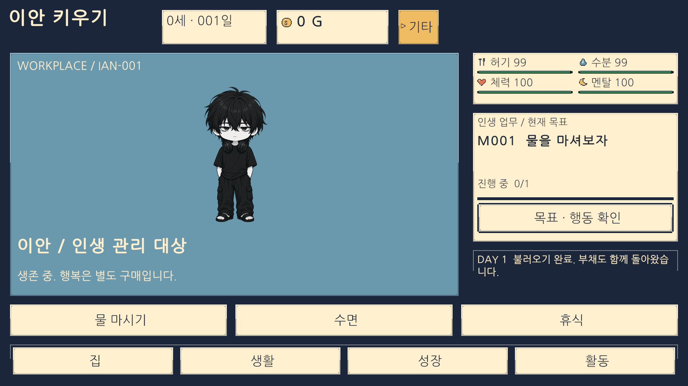

# Pixel overhaul addendum v1.1 — Unity review

2026-11-06 · Unity 6000.6.7f1 · URP 17.6 · 실제 씬 이름은 **Workplace**다. Workspace라는 중복 씬은 만들지 않았다. 기존 Home/School 슬라이스 위에 폰트와 City/Workplace 제작을 추가했다. 전체 상업 출시용 아트가 완성됐다는 판정은 아니다.

## 실제 Game View

| Home | School |
|---|---|
|  |  |

| City | Workplace |
|---|---|
|  |  |

| 작업 전 City | 작업 전 Workplace |
|---|---|
|  |  |

[720p 도시](After/City-1280x720.png) · [20:9 직장](After/Workplace-2400x1080.png) · [도시 활동창](After/City-Activities.png) · [직장 활동창](After/Workplace-Activities.png) · [편의점 직업 테마](After/Workplace-convenience-Fixture.png) · [실제 근무 급여 연출](After/Workplace-Payroll-Fixture.png)

Fixture 표기는 직업/나이/시간을 검증용으로 설정한 화면이다. 급여 화면은 그 상태에서 기존 근무 행동을 실행한 실제 결과이며, 연출이 돈을 별도로 지급하지 않는다. 1280/2400 해상도 캡처도 급여 검증 직후의 임시 성인 플레이 상태이며, 1920 기본 캡처와 나이·현금이 다를 수 있다. 모든 검증 뒤 원래 모델과 저장 슬롯을 복원했다. Draft 파일은 중간 점검용이며 최종 비교 대상이 아니다.

## 이번 변경

- Galmuri 한글 픽셀 TMP 체계: 본문·굵은 메뉴·타이틀·고정 폭 숫자, Nanum Gothic 기호 fallback. 한글 현대 음절 11,172개를 정적 아틀라스에 포함했다. 라이선스 전문은 게임 안에서도 볼 수 있다.
- 새 도시/사무실/편의점 이미지 에셋을 실제 씬에 적용했다. 기존 공식 이안 원본과 게임 규칙은 유지했다.
- 도시의 작은 3단 깊이 이동, 차량/보행/간판 프레임, 사무실 동료 타이핑/보행, 모니터·형광등 변화, 재사용 비 효과, 낮/저녁/밤 및 과로 조명을 연결했다.
- 동일 640×360, 100 PPU, Point, 월드 정수 확대 정책과 남색/황동 UI를 네 장소에 사용한다. UI는 별도 Canvas 스케일링을 유지한다.
- 기존 직업 ID에 따라 테마를 바꾼다. 사무직/개발자/분석가는 사무실 기반 변형, 편의점은 별도 실내다. 미구현 직업은 새로 구현하지 않았다.
- 기존 비동기 전환을 유지하며 12개 방향 프로필을 추가했다. 도착 UI의 텍스트/레이아웃 갱신이 끝난 뒤 오버레이를 걷도록 보강했다. 활동창 중복 탭과 글자 대비도 수정했다.

## 검증과 남은 일

새 통합 검사 **204개**, 기존 Phase 2.1 **45개**, Phase 2.2 **169개**가 통과했다. Phase23은 **440개 통과 후 구형 Stage1 Work 버튼 검사에서 중단**했다. 따라서 전체 기존 테스트가 모두 통과했다고 보고하지 않는다. 최종 컴파일 실패 플래그 false, 검증/Play 종료 구간 Console error/warning 0건이다.

한계와 실패 근거는 [VALIDATION.md](VALIDATION.md), 폰트 출처와 설정은 [FONT_SYSTEM.md](FONT_SYSTEM.md), 실제/미제작 에셋 구분은 [ASSET_REGISTER.md](ASSET_REGISTER.md)를 참조한다. Android는 Editor 해상도 확인까지이며 APK·실기기 성능 검증은 남아 있다.

작업 전 체크포인트: `visual-addendum-v1.1-start` (`159901f`). 작업 중 생긴 사용자/앱 커밋은 유지했다. 검토 시작: Bootstrap Play → MainMenu → Home → 활동 → 장소 이동. 직장에서는 ‘직장 활동’으로 기존 업무 기능을 연다.
