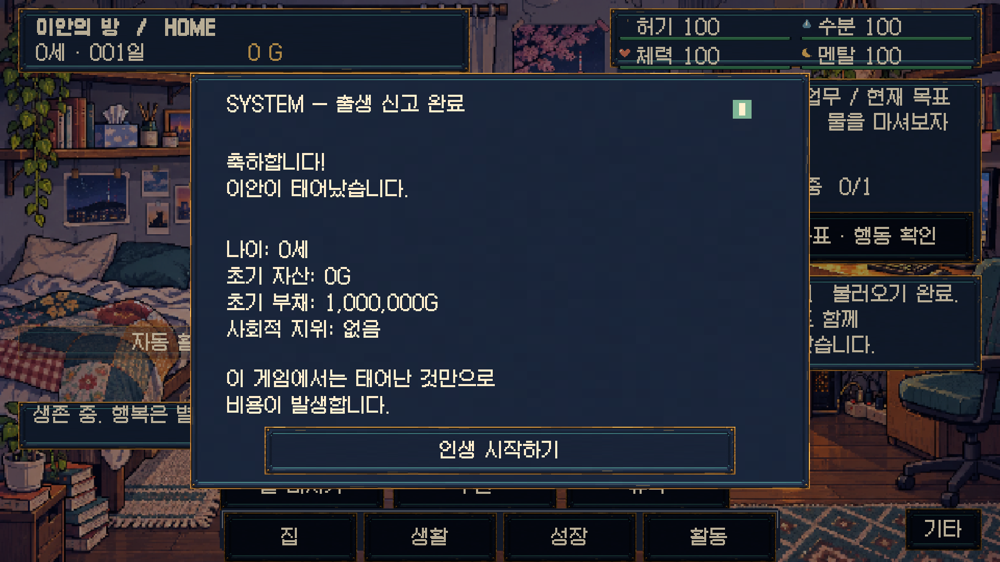
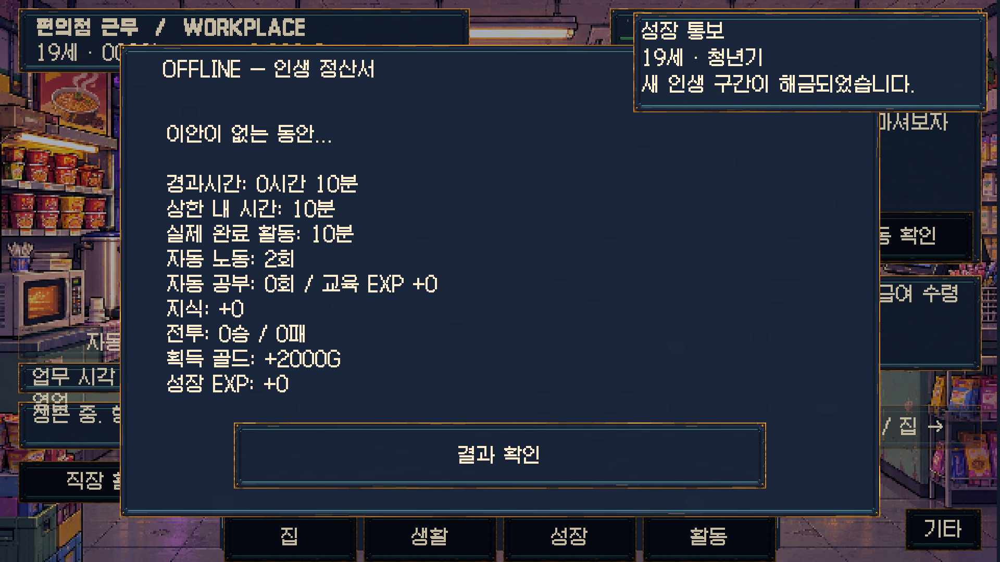
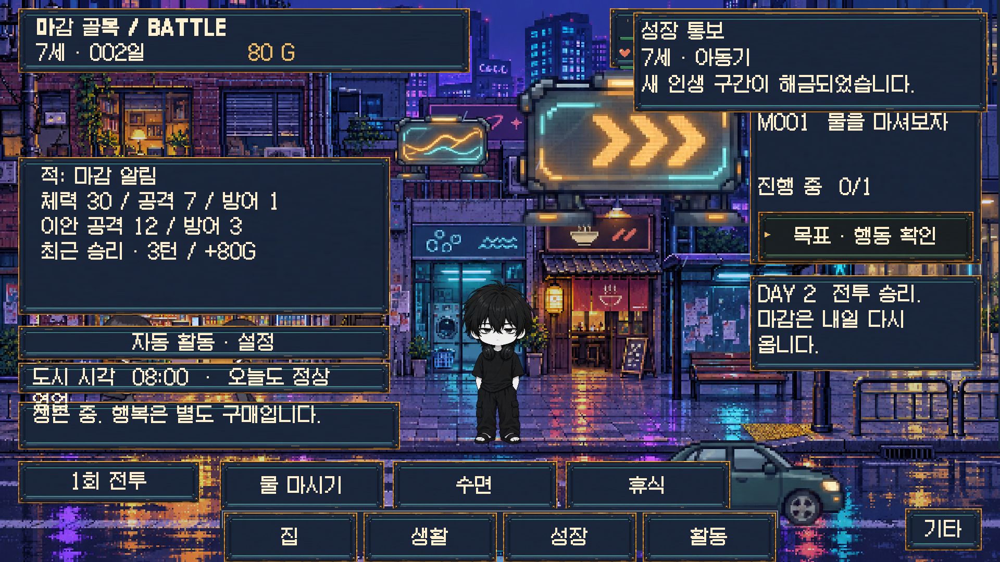
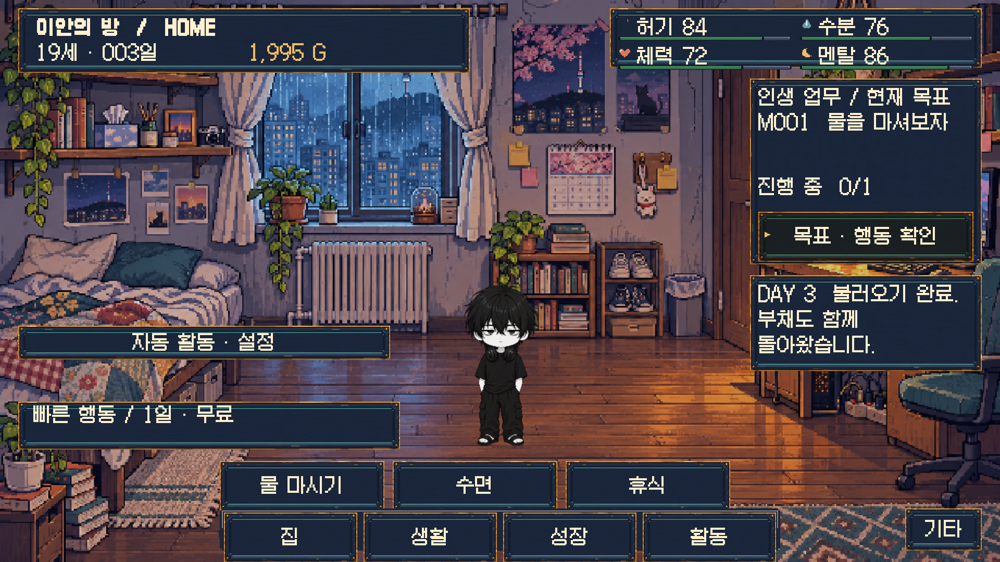
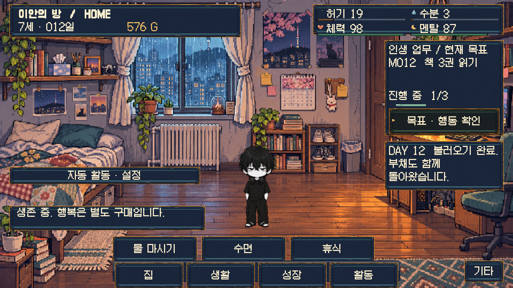
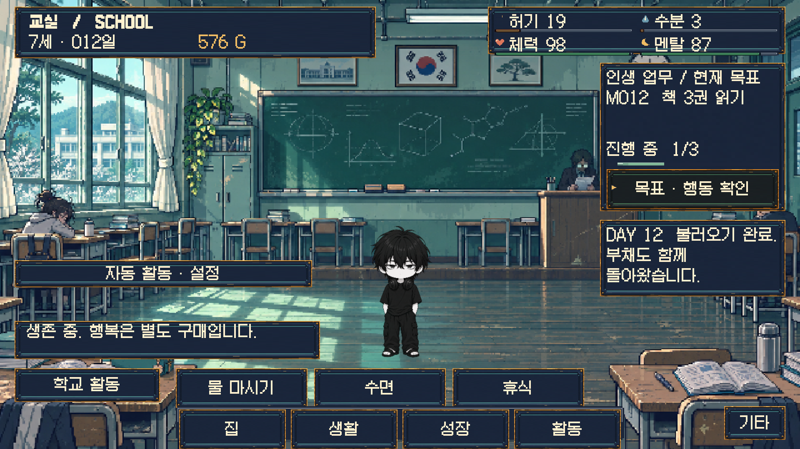
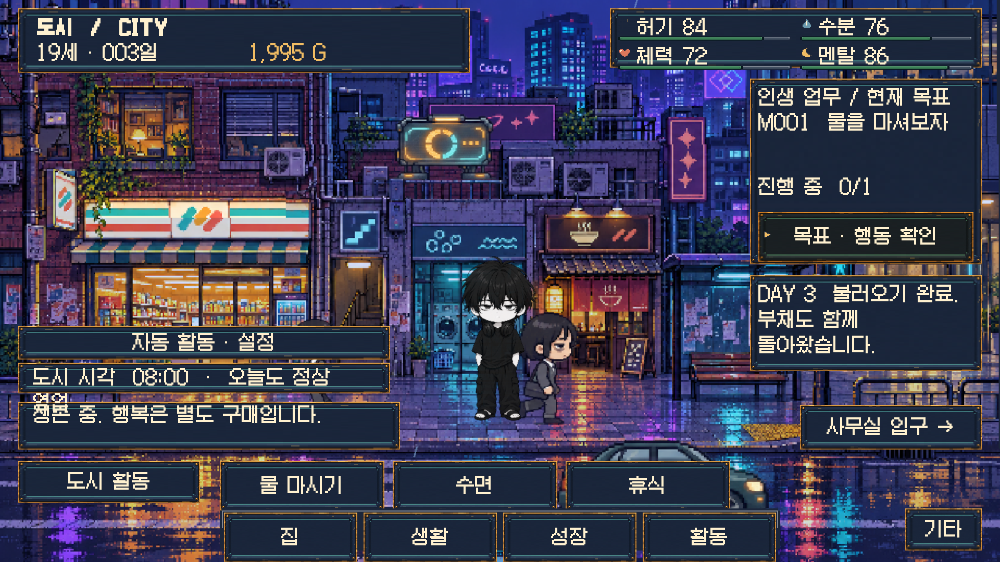
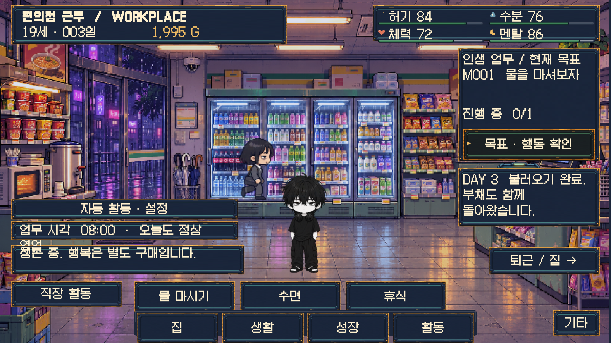

# UI fix · Phase 2.3 audit · Phase 2.4 review

공식 이안·기존 픽셀 배경을 유지하고 UI 가독성, 출생 소개, 실제 방치형 활동을 통합했다. 새로운 적/전투 배경 원화를 완성한 것은 아니며 Battle은 기존 도시/간판 아트를 재사용한다.

| 출생 신고: 새 게임 전용 | 오프라인 정산: 실제 계산 결과 |
|---|---|
|  |  |

| 실제 전투: 피해/승패/보상 기록 | 빠른 행동의 픽셀 서체 |
|---|---|
|  |  |

| Home | School |
|---|---|
|  |  |

| City | Workplace |
|---|---|
|  |  |

Fixture는 검증용 나이/직업/능력치/경과 시간을 설정한 경우다. 보상은 실제 서비스를 실행한 결과다. 일반 장소 캡처는 기존 진행 상태의 화면이며 출생 화면과 수치가 다를 수 있다.

- [UI/폰트·출생 수정 보고서](../UI_FONT_FIX_REPORT.md)
- [Phase 2.3 감사 및 COMPLETE 판정](../PHASE2_3_AUDIT.md)
- [Phase 2.4 구현·저장·테스트·제한](../PHASE2_4_PROGRESS.md)
- [개별 검사 집계](FINAL_VALIDATION_SUMMARY.json)
- [실제 Play 재시작 결과](IDLE_FRESH_PLAY_RESULTS.txt)
- [변경 파일 목록](CHANGED_FILES.txt)

시작: Bootstrap Play → MainMenu → 새 게임 → Home의 출생 신고. 자동 공부는 School에서 입학 후, 자동 노동은 Workplace에서 취업 후, 전투는 자동 활동 창의 ‘전투’로 이동해 시작한다. Home에는 요약/설정 진입만 추가했다. 기존 저장의 수동 불러오기는 자동 활동을 안전 정지하며 다시 설정할 수 있다.

빌드 결과는 BUILD_StandaloneWindows64.json / BUILD_Android.json에 기록한다. 빌드 성공과 실제 기기 실행/성능 검증은 구분한다. 아트의 남은 제작 범위는 기존 [등록부](../CommercialVisual/V11/ASSET_REGISTER.md)와 Phase2.4 보고서에 남겼다.
