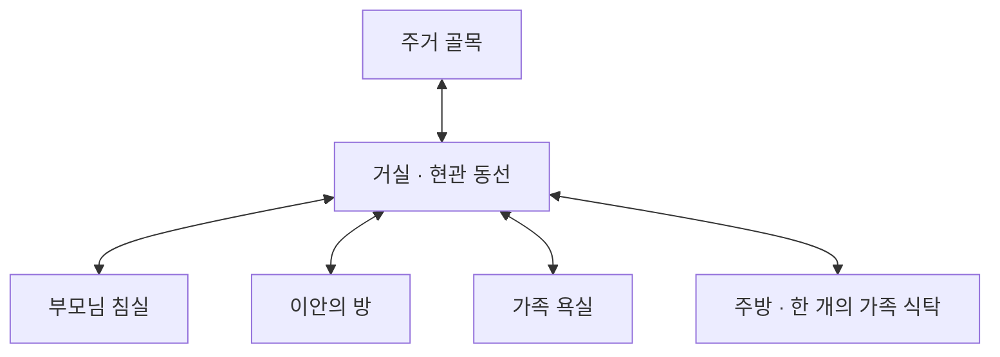

# 주거 및 Scene 아키텍처 개편 — 2026-11-14

시작: `/Users/hyunwol/IanGrowing`, Unity6000.6.8f1 Apple Silicon. 기존 Workspace와 원본 LifeWorld를 보존한 상태에서 실제 공간을16개 Scene으로 분리했다. 이전의 단일 LifeWorld 방 배치 방식은 일반 플레이 경로에서 사용하지 않는다.

## 실제 Scene 목록

| Unity Scene | 저장 RoomId | 표시 이름 |
|---|---|---|
| IndependentHome_Studio | `home` | 이안의 집 |
| IndependentHome_Bathroom | `bathroom` | 옥색 화장실 |
| ResidentialAlley | `alley` | 주거 골목 |
| City_Center | `city` | 도시 중심 |
| NeighborhoodShop | `shop` | 동네 상점 |
| Workspace_Office | `workplace` | 이안 사무실 |
| School_Classroom | `school` | 학교 |
| Resident_Housing | `residence` | 주민 생활관 |
| Workspace_Bathroom | `office-bathroom` | 사무실 화장실 |
| StockMarket_Interior | `finance` | 이안 증권 |
| RealEstate_Office | `realestate` | 이안 부동산 |
| FamilyHome_ParentsBedroom | `family-parents-bedroom` | 부모님 침실 |
| FamilyHome_IanBedroom | `family-ian-bedroom` | 이안의 방 |
| FamilyHome_Bathroom | `family-bathroom` | 가족 욕실 |
| FamilyHome_LivingRoom | `family-living` | 거실 |
| FamilyHome_Kitchen | `family-kitchen` | 주방 · 가족 식사 |

기존 Bootstrap/MainMenu/레거시 Home·School·StockMarket·LifeWorld 등은 삭제하지 않았다. 기존 SceneId 숫자는 유지하고 새 ID만 뒤에 추가했다. SceneRoutes와 RoomScenes 카탈로그, 전역 Build Scene List에 연결했다. 없는 카페·식당을 복제하거나 빈 현관·복도를 만들지 않았다. 기존 상점 기능은 NeighborhoodShop 안에 그대로 있다.

## 가족 주택의 논리적 평면

| 방 | 이전 분리안 | 최종 크기 | 의도 |
|---|---|---|---|
| 거실 |12×10|9.6×7|소파·TV·테이블·러그 및 출입 통로|
| 주방 |12×10|10×7|냉장고→조리→공동 식탁의 가까운 동선|
| 부모님 침실 |8×8|7.4×6.4|두 부모의 기존 침대·옷장·협탁|
| 이안의 방 |8×8|6.4×6.4|영아 잠자리·돌봄 접근 및 기존 수납|
| 가족 욕실 |8×8|5.2×4.6|세면대·변기·샤워·세면도구·수건 바구니·매트|

좌표 원본은 `Assets/_Game/Data/SceneArchitecture/FamilyRoomLayout.json`이다. 가구 위치와 벽/문턱을 Editor에서 Scene에 저장하며, Play 중 방을 다시 생성하지 않는다. 기존 집 전체 좌표 범위는 구버전 세이브의 좌표 변환에만 사용한다. 바닥 중앙 Pivot과 벽 하단 Pivot을 구분하여 경계가 맞도록 계산한다. 부모 Transform을 반대로 돌리거나 오프셋을 누적하지 않는다. 벽에는 시각 요소와 실제 Collider가 있고, 남쪽 벽은 낮은 가림 벽으로 처리한다. 기존 픽셀 아트/한글 폰트/문짝 연출을 재사용한다.

## 공유 상태와 공간 소유권

- Bootstrap의 기존 GameContext/GameManager/SaveManager/시계/성장/경제/미션은 DontDestroyOnLoad 루트 하나를 유지한다.
- 방 Scene에는 그 장소의 배치·충돌·상호작용·카메라·플레이어 표현·HUD만 둔다. 들어오는 방 활성화 전에 나가는 방 전체를 비활성화하고 이후 언로드한다. 동시에 여러 방을 유지하는 방식이 아니다.
- HUD/미션 프레젠터는 기존 GameplaySceneBindings로 동일 전역 모델에 연결한다. 모델을 방마다 생성하지 않는다.
- 기존 LifeWorldSnapshot.zone이 안정적인 RoomId를 저장한다. 위치는 방 내부 좌표이며 실제 씬 이름은 카탈로그에서 찾는다. 기존 큰 월드 좌표는 legacyZone/legacyOffset으로 변환한다.
- NPC17명의 논리 상태/일정/관계는 기존 전역 snapshot에 남는다. 현재 방에 있는 인물만 물리 오브젝트로 만들고, 새 도착 인물은 문 진입 지점이 비었을 때 생성하여 실제 경로 이동을 시작한다. 좌석 예약·움직임 방향은 기존 Scheduler가 담당한다.
- 가족 가구는 Scene 소유이며 개인 구매 목록으로 이전되지 않는다. 개인 가구는 기존 owned/placed와 HomeId·RoomId·ownership·installed·direction을 저장한다. 구버전 필드 누락은 기존 설치 가구를 유지하는 기본값으로 보완한다.

## 주거와 연령

0세 보행 금지,1세 보행,7세 독립 외출,19세 이후 선택 독립을 별도 조건으로 유지한다. 0–18세는 가족 주거이며19세가 되어도 자동 이사하지 않는다. 기존500G 거래가 성공한 뒤에만 개인 집의 문과 두 표지판을 활성화한다. UI·문·직접 Scene 전환이 동일한 기존 성장/거주 상태를 검사한다. 개인 집은 기존 작은 스튜디오와 독립 옥색 욕실로 구성했다. 최초 일반 가구는 침대 하나이고 추가 가구는 기존 경제로 구매한다. 기존 성인 세이브와 개인 소유 가구는 삭제하지 않는다.

## 문과 전환

WorldDoor/WorldDoorLeafVisual의 개폐·경첩·충돌 코드는 교체하지 않았다. 문은 기존 실제 열림/통과를 완료한 뒤 전역 SceneTransitionService에 목적지 RoomId와 EntryId를 넘긴다. 출발·도착 문과 진입 방향을 카탈로그에 명시했다. 도착 문이 열린 뒤 물리 입력을 복구하여 닫힌 Collider가 스폰 위치를 밀어내지 않게 한다. 로딩 동안 중복 입력을 차단하고 픽셀 페이드/기존 전환 프레젠터를 사용한다.

## 실제 검증 및 제한

실행 결과와 실패 이력은 [RESULTS.md](SceneArchitecture/RESULTS.md), 원본 JSON과 Game View는 [SceneArchitecture](SceneArchitecture/)에 보존한다. `Ian/Scene Architecture` 메뉴와 기존 로컬 Editor bridge로 재생성/QA를 실행할 수 있다. 일반 실행은 Bootstrap을 열고 Play한다.

실제 Android/iOS/Fold 기기, 저사양 발열/FPS, 모든 생애 단계의 전용 동작 아트, 보호자 동반 외출, 모든 오프라인 구간의 조리 이력 재생은 이번 검증으로 완료 처리하지 않는다. 기존 정식 가챠/확장 장비 등 미구현 항목도 그대로 구분한다. Workspace·학교·경제·미션 전체를 신규 구현했다고 주장하지 않는다.

## 복구와 저장

원본 LifeWorld.unity와 LifeWorldRules.asset은 시작 백업과 바이트가 동일하다. 백업은 DevelopmentBackups/SceneArchitecture-20261114에 있다. 사용자 확인을 받은1세/100G 생산 세이브3개를 해시로 보호한다. 이전0세 백업으로 되돌리지 않는다. 자동 테스트는 phase26-/qa- 전용 슬롯을 사용한다. 원격 origin은 설정돼 있으나 이번 작업에서 push하지 않았다. 로컬 커밋/백업만으로 장비 손실에 대비한 원격 보관이 완료되는 것은 아니다.
